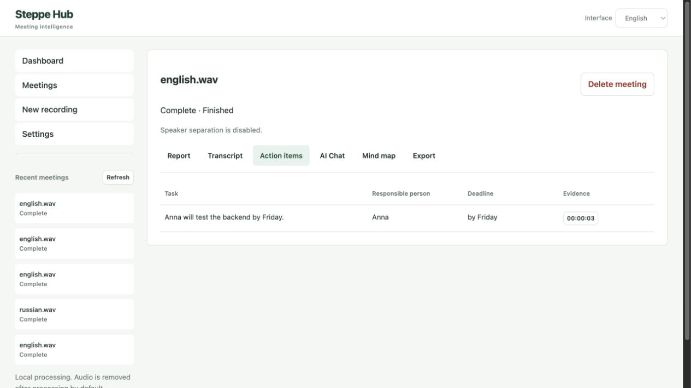

# Steppe Hub — AI Meeting Intelligence

[Русская версия](README.ru.md)

A local AI meeting assistant that turns audio into timestamped transcripts, structured
reports, action items and answers linked to their source passages.

Review what was decided, who owns the next task and where it was discussed. Steppe
Hub runs speech recognition and language models locally, with a FastAPI backend,
a persistent meeting library and a bilingual browser interface.



[Dashboard](docs/screenshots/dashboard.png) · [Transcript](docs/screenshots/transcript.png) · [Report](docs/screenshots/meeting-report.png) · [Mind map](docs/screenshots/mind-map.png) · [Russian interface](docs/screenshots/workspace-ru.png)

## Features

- WAV, MP3, M4A, FLAC and OGG uploads with size, duration and decode validation.
- Faster-Whisper transcription with timestamps, VAD and English/Russian/automatic language selection.
- Optional Pyannote speaker separation; unknown speakers remain unknown when unavailable.
- Local Ollama reports: overview, topics, discussion, decisions, tasks, open questions and takeaways.
- BM25 retrieval followed by grounded Q&A with clickable transcript references.
- SQLite meeting history, interrupted-job recovery, speaker aliases and confirmed deletion.
- Transcript search/copy, real processing stages, upload progress and analysis retry.
- Independent interface, audio and report languages; English/Russian UI preference persists locally.
- Safe SVG mind maps with zoom, evidence links and SVG download; no diagram code generated by an LLM.
- UTF-8 TXT, Markdown, JSON, action-item CSV and Unicode PDF exports.

## Architecture and stack

```text
Vanilla HTML/CSS/JS → FastAPI → SQLite metadata + UUID media directories
                              ↓ one bounded job at a time
                        Killable subprocess
                       Faster-Whisper (CPU)
                       optional Pyannote (CPU)
                       structured Ollama analysis

Question → BM25 transcript retrieval → Ollama → validated references
Report → local SVG visualization / TXT / Markdown / JSON / CSV / PDF
```

Python 3.11+ (verified on 3.12, macOS arm64), FastAPI, Pydantic, Uvicorn,
Faster-Whisper, CTranslate2, ffmpeg, Ollama, SQLite, ReportLab and pytest.
See [architecture](docs/ARCHITECTURE.md), [audit](docs/TECHNICAL_AUDIT.md),
[development](docs/DEVELOPMENT.md), and [verification](docs/VERIFICATION.md).

## Install on macOS

```bash
brew install python@3.12 ffmpeg ollama
git clone https://github.com/muratkareem/hackathon-audio.git
cd hackathon-audio
python3.12 -m venv .venv
.venv/bin/python -m pip install -r backend/requirements-ai.txt -r backend/requirements-dev.txt
cp .env.example .env
ollama pull qwen2.5:7b
```

Start the Ollama application, or run `ollama serve` in another terminal before
pulling/running a model. Do not start a second server if Ollama is already running.
The first Whisper job downloads `small` (approximately 460 MB). Models are cached
under ignored `data/models/`; install/download before an offline demonstration.
A tested macOS/Python 3.12 dependency snapshot is available as
`backend/constraints-macos-py312.txt` (`pip install -c ... -r ...`). It is a platform
snapshot, not a universal lock for every OS or optional Pyannote combination.

## Configuration

| Variable | Default | Meaning |
|---|---|---|
| `WHISPER_MODEL` | `small` | Model name or local compatible CTranslate2 model directory |
| `WHISPER_COMPUTE_TYPE` | `int8` | Must be supported by installed CPU backend |
| `OLLAMA_MODEL` | `qwen2.5:7b` | Exact installed tag; inspect Model settings in the UI |
| `ENABLE_DIARIZATION` | `false` | Enable optional Pyannote |
| `HF_TOKEN` | empty | Optional gated-model access; never commit |
| `MAX_UPLOAD_MB` | `200` | File size limit |
| `MAX_AUDIO_SECONDS` | `7200` | Duration limit |
| `JOB_TIMEOUT_SECONDS` | `7200` | Kill the job process after this limit |
| `LLM_TIMEOUT_SECONDS` | `180` | Ollama HTTP timeout |
| `RETAIN_AUDIO` | `false` | Keep source audio for playback until meeting deletion |
| `STEPPE_DATA_DIR` | `data/runtime` | Private runtime storage |
| `PDF_FONT_PATH` | auto | Unicode TrueType font path |

The local Ollama endpoint is fixed to `127.0.0.1:11434`; no cloud inference endpoints.
For smaller/larger Whisper models, select `small`, `medium`, `large-v3-turbo`, etc.
Larger models increase memory and latency; only `small` was tested live here.
CTranslate2 uses CPU, **not Metal**. Verified CPU types: `int8`, `int8_float32`,
`float32`. The optional Pyannote path also explicitly uses CPU.

For optional diarization:

```bash
.venv/bin/python -m pip install -r backend/requirements-diarization.txt
```

Accept the required Hugging Face model access terms for
`pyannote/speaker-diarization-3.1` and its dependent models using your own account.
Set `HF_TOKEN` and `ENABLE_DIARIZATION=true` in `.env`. Missing credentials,
incompatible dependencies or gated access produce an unavailable status while
transcription/analysis continue. This does not identify real people from voices.
Optional diarization was tested with mocks, not live gated model access.

## Run

```bash
./run_api.sh
```

Open [localhost:8000](http://127.0.0.1:8000). Startup never installs dependencies or
loads AI models. Run **one Uvicorn worker**; this is a single-user desktop service.
Default host binding is loopback. Do not expose it to a network without adding
authentication and revisiting storage/concurrency boundaries.

## Example workflow

1. Select audio language and report language separately; choose an interface language.
2. Drop a non-sensitive recording, then process it. Progress represents actual stages,
   not an estimate of seconds remaining.
3. Open the saved meeting, inspect the report and follow references to the transcript.
4. Search speech or rename available speaker labels. Original transcription remains intact.
5. Ask a question using words from the recording; inspect its supporting timestamps.
6. Open the mind map or download a report. Delete the meeting when no longer needed.

If Ollama fails, transcription is retained and **Retry analysis** does not repeat ASR.
With default retention, audio is removed after processing (including failure); a
failed transcription requires re-upload. Enable retention before uploading if you
need timestamp-seeking playback. Metadata/reports stay until explicit deletion.

## Tests and verification

```bash
./run_test.sh -q
.venv/bin/python -m ruff check backend tests scripts
npm ci --ignore-scripts --prefix frontend
npm test --prefix frontend
node --check frontend/app.js
.venv/bin/python scripts/benchmark.py
# Live, requires running server, downloaded models and an explicitly supplied safe sample:
.venv/bin/python scripts/live_check.py /path/to/synthetic.wav en
```

The verified suite has **51 backend tests and 5 frontend interaction tests**.
Automated tests mock AI inference and generate fixtures; no model downloads occur.
English and Russian live synthetic speech runs were separately verified with
Whisper `small` and Ollama `qwen2.5:7b`. Exact counts, timings, limitations and browser
checks are recorded in [verification](docs/VERIFICATION.md). Synthetic speech is a
smoke test, not an accuracy benchmark for real meetings.

## Troubleshooting and limitations

- **Ollama unavailable/model missing:** start Ollama, pull the exact configured tag,
  check Model settings, then retry analysis. Model lists never include credentials.
- **Processing failed:** install AI dependencies, check model access and CPU compute
  type. PyAV is pinned because version 19 is incompatible with this Faster-Whisper version.
- **PDF font missing:** set `PDF_FONT_PATH` to DejaVu Sans or another licensed Unicode
  TrueType font. macOS uses installed Arial when available; Linux uses installed
  DejaVu Sans. No proprietary font file is committed.
- **Busy:** another AI task is running; the app intentionally rejects a second job.
- **Interrupted:** restart marks unfinished jobs as failed instead of leaving them pending.
- BM25 is lexical: paraphrases, morphology and cross-language questions can miss evidence.
- LLM schema/reference validation checks shape and source IDs, not factual truth.
  Whisper can mishear technical names; verify decisions and tasks against audio.
- Long recordings use bounded chunking and pairwise report synthesis. Very large
  partial reports fail explicitly rather than silently exceeding the context cap.
  This path is unit-tested, not benchmarked on multi-hour recordings.
- Overlapping speakers use the greatest-overlap label per ASR segment. No word-level
  overlap splitting or reliable simultaneous-speaker transcription is promised.
- No PNG export, cloud sync, multi-user authentication, embeddings or vector database.

## Privacy and ownership

No application analytics, CDN scripts or automatic audio uploads. Model-library
telemetry is disabled where supported. Initial package/model downloads contact
registries; local Ollama, downloaded models and their licenses remain separate
software. Runtime files are unencrypted; OS accounts, backups, malware, browser
extensions and a network-exposed server can compromise privacy. Local does not
mean absolute confidentiality. Do not put private audio or transcripts in Git.

Original attribution remains with the repository contributors. No license
was present in the original checkout; this work does not invent or grant one. The
owner should choose licensing after checking contributions and dependencies.
