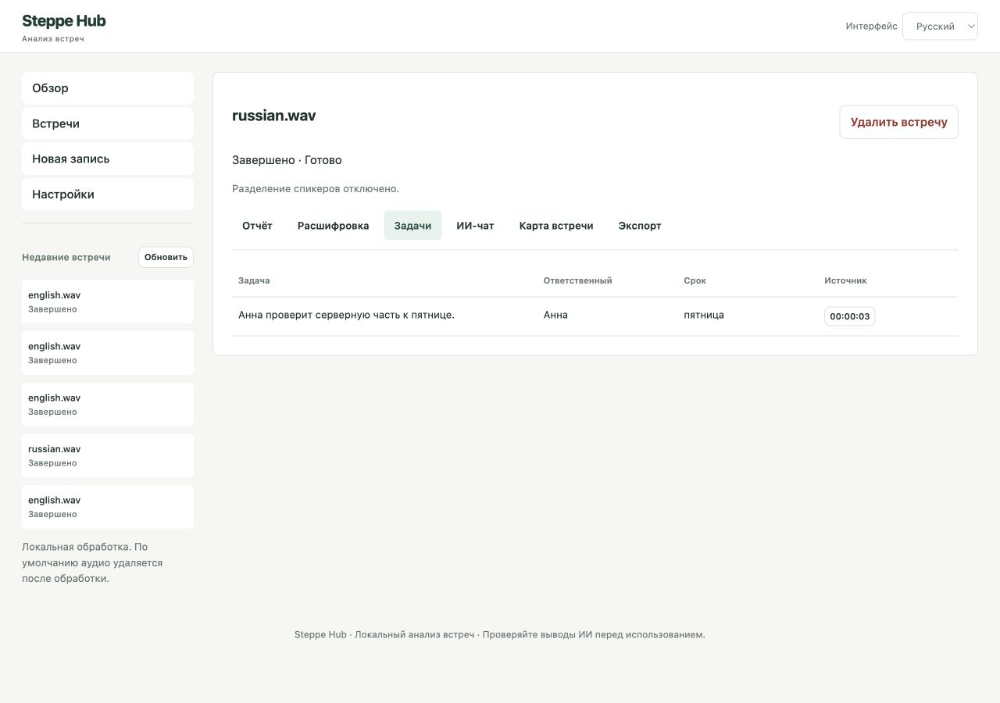

# Steppe Hub — AI Meeting Intelligence

[English version](README.md)

Локальный помощник для анализа встреч на FastAPI и обычном JavaScript.
Приложение распознаёт аудио, сохраняет таймкоды, формирует решения и задачи,
отвечает на вопросы по найденным фрагментам и экспортирует результаты.
Сохранены стек исходного проекта и его основа поиска BM25.



## Реализованные возможности

- Загрузка WAV, MP3, M4A, FLAC и OGG с проверкой размера, длительности и декодирования.
- Faster-Whisper с VAD, таймкодами и выбором русского, английского или автоматического определения языка.
- Необязательное разделение спикеров Pyannote; при недоступности спикеры не выдумываются.
- Отчёты Ollama: обзор, темы, обсуждения, решения, задачи, открытые вопросы и выводы.
- Поиск BM25 по расшифровке перед генерацией ответа, ссылки на исходные таймкоды.
- История SQLite, восстановление статуса прерванных задач, имена спикеров и удаление с подтверждением.
- Поиск и копирование расшифровки, реальные этапы обработки и повторный анализ без повторного ASR.
- Независимые языки интерфейса, аудио и отчёта; сохранение языка интерфейса в браузере.
- SVG-карта из проверенных данных с масштабированием, переходами к источникам и скачиванием.
- TXT, Markdown, JSON, CSV задач и PDF с кириллицей.

## Архитектура и технологии

HTML/CSS/JS → FastAPI → SQLite и каталоги аудио с UUID. Один отдельный процесс
последовательно выполняет Faster-Whisper, необязательный Pyannote и анализ Ollama.
Процесс можно завершить по тайм-ауту, пока API продолжает обслуживать запросы.
Вопрос → поиск BM25 → локальная LLM → ответ с проверенными идентификаторами источников.

Python 3.11+ (проверен 3.12 на macOS arm64), FastAPI, Pydantic, Uvicorn,
CTranslate2, ffmpeg, Ollama, SQLite, ReportLab, pytest.
Подробности: [архитектура](docs/ARCHITECTURE.md), [аудит](docs/TECHNICAL_AUDIT.md),
[разработка](docs/DEVELOPMENT.md), [проверки](docs/VERIFICATION.md).

## Установка на macOS

```bash
brew install python@3.12 ffmpeg ollama
git clone https://github.com/muratkareem/hackathon-audio.git
cd hackathon-audio
python3.12 -m venv .venv
.venv/bin/python -m pip install -r backend/requirements-ai.txt -r backend/requirements-dev.txt
cp .env.example .env
ollama pull qwen2.5:7b
```

Перед загрузкой модели запустите приложение Ollama или `ollama serve` в другом
терминале. Если сервис уже работает, второй запуск не нужен. Первый запуск Whisper
скачивает `small` (около 460 МБ). Кэш `data/models/` исключён из Git. Для офлайн-показа
заранее установите зависимости и модели. Проверенный снимок зависимостей для macOS
и Python 3.12: `backend/constraints-macos-py312.txt`; его можно передать pip через
`-c`. Это не универсальный lock-файл для всех ОС и сочетаний Pyannote.

## Настройка

В `.env`:

| Переменная | По умолчанию | Назначение |
|---|---|---|
| `WHISPER_MODEL` | `small` | Имя модели или путь к совместимой локальной модели |
| `WHISPER_COMPUTE_TYPE` | `int8` | Поддерживаемый тип вычислений CPU |
| `OLLAMA_MODEL` | `qwen2.5:7b` | Точный установленный тег |
| `ENABLE_DIARIZATION` | `false` | Необязательное разделение спикеров |
| `HF_TOKEN` | пусто | Доступ к закрытым моделям; не добавлять в Git |
| `MAX_UPLOAD_MB` | `200` | Максимальный размер файла |
| `MAX_AUDIO_SECONDS` | `7200` | Максимальная длительность |
| `JOB_TIMEOUT_SECONDS` | `7200` | Предельное время отдельного процесса |
| `LLM_TIMEOUT_SECONDS` | `180` | Тайм-аут HTTP-запроса Ollama |
| `RETAIN_AUDIO` | `false` | Сохранить аудио для воспроизведения до удаления встречи |
| `STEPPE_DATA_DIR` | `data/runtime` | Локальное хранилище |
| `PDF_FONT_PATH` | автоматически | Путь к Unicode-шрифту TrueType |

Ollama доступна только по `127.0.0.1:11434`. Облачных адресов инференса нет.
Для Whisper можно выбрать `medium` или `large-v3-turbo`, но они требуют больше
памяти и времени. Вживую проверена только `small`. CTranslate2 работает на **CPU,
не Metal**. Проверенные типы: `int8`, `int8_float32`, `float32`. Pyannote также
настроен на CPU.

Для необязательной диаризации:

```bash
.venv/bin/python -m pip install -r backend/requirements-diarization.txt
```

Самостоятельно примите условия доступа Hugging Face для
`pyannote/speaker-diarization-3.1` и зависимых моделей. Укажите `HF_TOKEN` и
`ENABLE_DIARIZATION=true`. При отсутствии доступа или несовместимости зависимостей
расшифровка и анализ продолжаются с явным предупреждением. Это разделение реплик,
а не установление личности по голосу. В этой проверке Pyannote тестировался с
подменой модели, без живого запуска закрытых весов.

## Запуск и пример работы

```bash
./run_api.sh
```

Откройте [localhost:8000](http://127.0.0.1:8000). Скрипт не переустанавливает пакеты
и не загружает модели при старте сервера. Требуется **один worker Uvicorn**.

1. Выберите языки интерфейса, аудио и отчёта независимо друг от друга.
2. Перетащите безопасную тестовую запись и запустите обработку.
3. Откройте отчёт и перейдите по таймкодам к исходным фрагментам.
4. Найдите нужный текст; при доступной диаризации переименуйте спикеров.
5. Задайте вопрос, используя слова из записи, и проверьте ссылки в ответе.
6. Посмотрите карту, скачайте отчёт или удалите встречу с подтверждением.

Если Ollama недоступна, сохранённую расшифровку можно проанализировать повторно.
По умолчанию аудио удаляется после обработки, включая сбои; для повторного ASR
потребуется новая загрузка. Для воспроизведения включите хранение до загрузки.
Отчёты и метаданные остаются до удаления встречи.

## Проверки

```bash
./run_test.sh -q
.venv/bin/python -m ruff check backend tests scripts
npm ci --ignore-scripts --prefix frontend
npm test --prefix frontend
node --check frontend/app.js
.venv/bin/python scripts/benchmark.py
.venv/bin/python scripts/live_check.py /path/to/synthetic.wav ru
```

**Проверены 51 тест бэкенда и 5 тестов интерфейса.**
Автотесты используют подмену ИИ и сгенерированные фикстуры, без скачивания моделей.
Отдельно проверены реальные английская и русская синтетические записи с Whisper
`small` и Ollama `qwen2.5:7b`, включая вопросы и экспорты. Точные результаты находятся
в [отчёте о проверках](docs/VERIFICATION.md). Синтезированная речь не заменяет оценку
точности на шумных встречах с несколькими людьми.

## Устранение проблем и ограничения

- Ollama недоступна: запустите сервис, установите точный тег модели и повторите анализ.
- Ошибка обработки: проверьте зависимости ИИ, доступ к модели и тип вычислений.
  PyAV закреплён на совместимой версии: версия 19 ломает используемый Faster-Whisper.
- Нет PDF-шрифта: укажите лицензированный Unicode TrueType в `PDF_FONT_PATH`.
  На macOS используется установленный Arial, на Linux — DejaVu Sans; файлы
  проприетарных шрифтов не включены в репозиторий.
- Занято: дождитесь текущей задачи. Параллельный тяжёлый инференс намеренно ограничен.
- Прерванные задачи после перезапуска помечаются ошибкой, а не остаются в очереди.
- BM25 не понимает все перефразирования, словоформы и вопросы на другом языке.
- Проверка JSON и ссылок не доказывает истинность фактов. ASR ошибается в названиях,
  а LLM может неточно классифицировать решения. Проверяйте результаты по аудио.
- Длинные записи обрабатываются частями с попарным объединением отчётов. Слишком
  большой контекст приводит к явной ошибке. Многочасовые записи не измерялись вживую.
- Для пересекающихся реплик выбирается спикер с наибольшим пересечением сегмента.
- Нет PNG-экспорта, облачной синхронизации, многопользовательской авторизации и векторной БД.

## Конфиденциальность и лицензия

Нет аналитики приложения, CDN-скриптов и автоматической отправки аудио в облако.
Телеметрия библиотек моделей отключается там, где поддерживается. Первые загрузки
пакетов и моделей обращаются к внешним реестрам. Данные на диске не зашифрованы;
резервные копии, другие процессы и расширения браузера могут нарушить приватность.
Не публикуйте сервер в сети без отдельной защиты. Локальная работа не означает
абсолютную конфиденциальность. Не добавляйте личные записи и расшифровки в Git.

Сохраняется авторство участников исходного проекта. Лицензия в исходном репозитории
не обнаружена; новая лицензия автоматически не добавлялась. Её должен выбрать
владелец с учётом вкладов и зависимостей.
